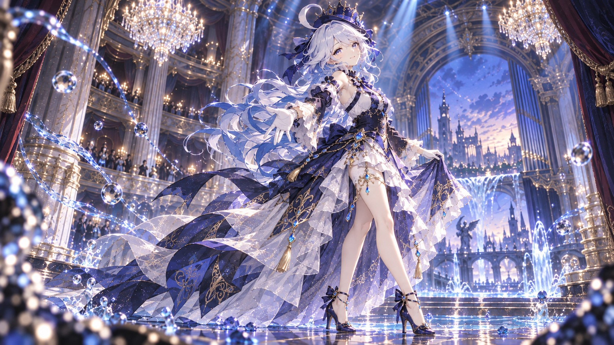

# DSH Wallpaper

A DSH Desktop decoration bundle: a customizable startup movie, the
“水光歌剧院中的优雅舞者” wallpaper, and a live DeepSeek balance chip.



## Install from the plugin index

Add this URL in **Plugins → Discover → Add index source**:

```text
https://raw.githubusercontent.com/Wjkstra/dsh-wallpaper/main/v1/index.json
```

Then install **Furina desktop decoration** (`dsh-furina-decoration`). If raw
GitHub is blocked on your network, serve the same `index.json` and `icon.svg`
from GitHub Pages or any static HTTPS host and use that URL instead.

## What it adds

- **Startup movie** — plays on page load with a progress line, an
  original-sound toggle, and `Esc`/skip.
- **Wallpaper** — the water-opera image above, under a dark wash so the chat,
  sidebar, menus, and settings stay readable.
- **Balance card** — sits in the sidebar footer above Settings, so it never
  covers page controls; shows recharge balance, spent, granted bonus, and
  last-read time, polled every five minutes through the signed-in DeepSeek
  account.

## Custom media

Open **Settings → Desktop decoration** (设置 → 桌面装饰):

- **开机动画** — choose MP4 or WebM, up to 300 MB; preview or restore the default.
- **背景** — choose JPG, PNG, WebP, GIF, or BMP, up to 50 MB; live preview and
  restore default.

Uploads live under `$DSH_HOME/furina-media` (normally
`C:\Users\<you>\.dsh\furina-media`) and survive restarts.

## Repository layout

- `plugin/` — the DSH bundle; this is the Git install source (`path: plugin`).
- `index.json` — the plugin-market index.
- `icon.svg` — the icon referenced by the index.
- `plugin/assets/background.jpg` — the default wallpaper.
- `plugin/assets/boot.mp4` — the default startup movie.

## Media

The wallpaper was supplied by the repository owner. The startup movie was
copied from a local `dsh-desktop` installation. See
[`plugin/THIRD_PARTY_NOTICES.md`](plugin/THIRD_PARTY_NOTICES.md).
